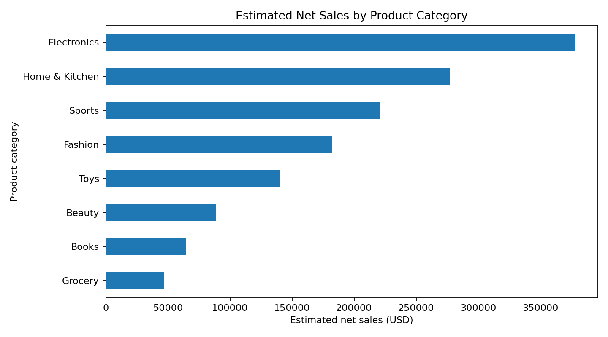
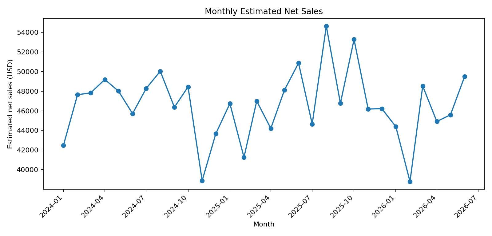
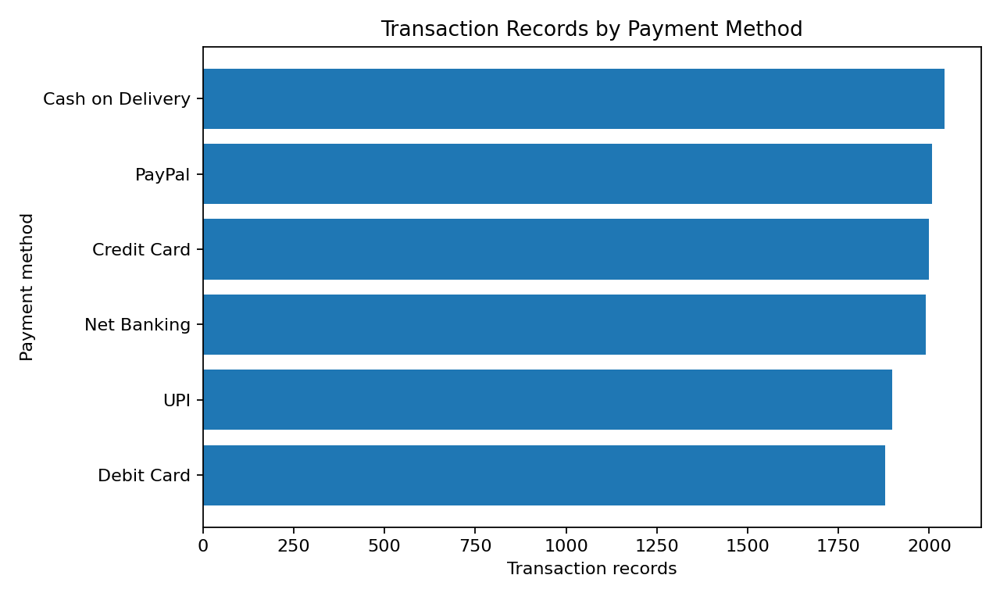
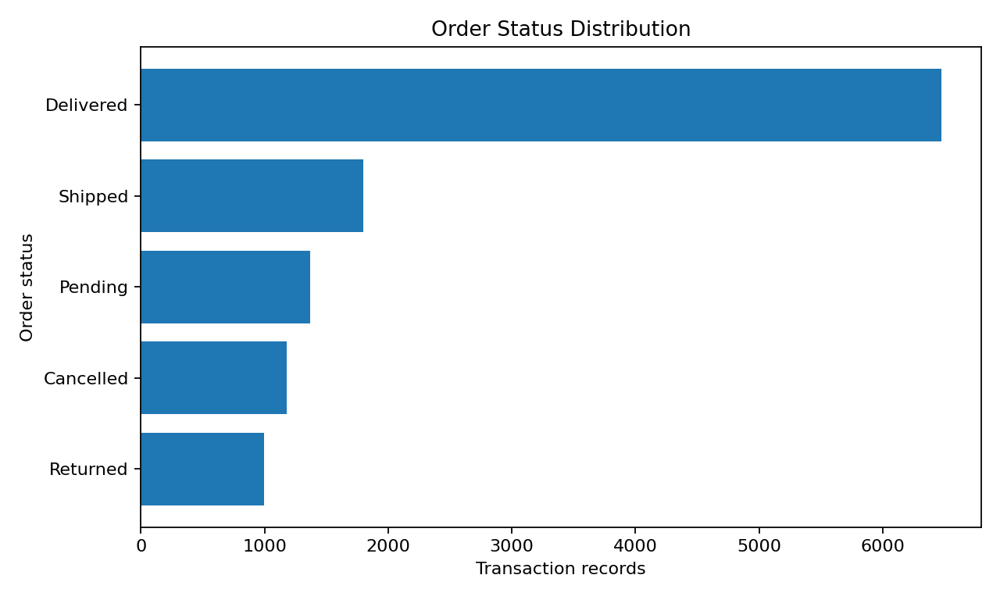
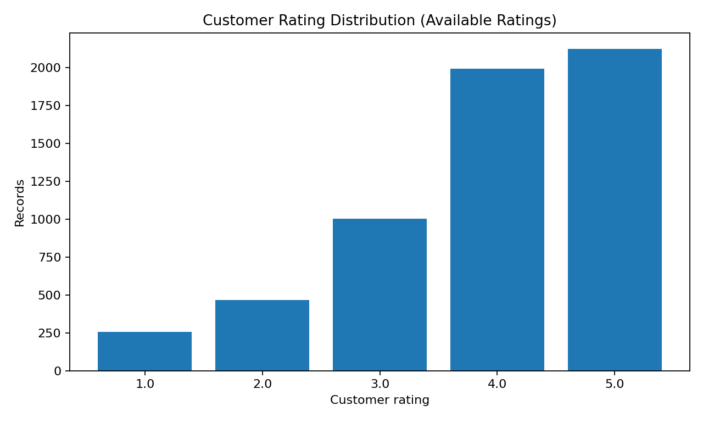
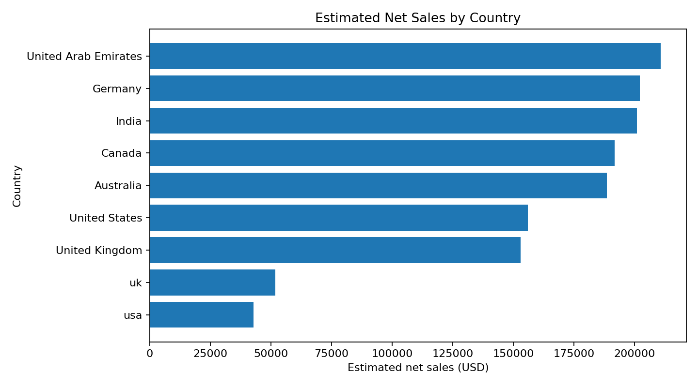

# E-Commerce Retail Analytics: From Data Cleaning to Interactive Dashboard

**Project:** SWYNEX Technologies Data Analyst Internship — Final Analytics Case Study (Task 4)  
**Author:** Shubham Umesh Raut  
**Tools:** Python, Pandas, NumPy, Matplotlib, HTML, CSS, JavaScript  
**Dataset:** `ecommerce_retail_transactions_cleaned.csv`  
**Analysis period:** 2024-01-01 to 2026-06-30

## Executive summary

This case study brings together the end-to-end workflow completed across Tasks 1–3: preparing an e-commerce transaction dataset, exploring it statistically, extracting business-relevant findings, and presenting the results through an interactive browser-based dashboard.

The dataset contains **11,814 transaction records and 16 original columns**, representing **3,368 unique customer IDs** and **8 product categories** across **9 countries**. Using quantity, unit price, and discount percentage, the analysis estimates gross sales of **$1,500,541.86**, discounts of **$102,514.78**, and net sales of **$1,398,027.08**. These are analytical estimates, not audited accounting revenue.

The most important findings are that **Electronics** is the largest category by estimated net sales (27.0% of the total), **United Arab Emirates** is the leading country by estimated net sales (15.1%), and **Cash on Delivery** is the most frequently recorded payment method (17.3% of transaction records). Data completeness is a meaningful limitation: customer ratings are missing in **5,968 records (50.5%)**.

## 1. Problem statement

E-commerce transaction data can contain useful signals about product performance, customer purchasing patterns, discounts, payment preferences, order statuses, and geographic markets. However, those signals are difficult to use consistently without preparing the data, calculating comparable metrics, exploring patterns, and communicating findings clearly.

**Problem statement:** How can the supplied e-commerce transaction dataset be prepared, analyzed, and presented so that a stakeholder can quickly understand estimated sales performance, transaction patterns, geographic concentration, customer feedback coverage, and potential areas for further investigation?

## 2. Project objectives

1. Review the dataset structure, field types, missing values, and duplicate records.
2. Prepare an analysis-ready dataset and document important data-quality limitations.
3. Calculate descriptive statistics and estimated sales metrics.
4. Analyze sales by category, month, product, and country.
5. Examine payment methods, order statuses, and customer-rating patterns.
6. Develop an interactive dashboard with KPIs, charts, and filters.
7. Convert the analysis into clear, cautious, business-oriented recommendations.

## 3. Dataset information

- **Rows:** 11,814
- **Original columns:** 16
- **Unique order IDs:** 11,814
- **Unique customer IDs:** 3,368
- **Date range:** 2024-01-01 to 2026-06-30
- **Product categories:** 8
- **Countries:** 9
- **Exact duplicate rows:** 0

### Key fields

| Field | Description / use |
|---|---|
| `order_id` | Order identifier; used for transaction-record summaries |
| `customer_id` | Customer identifier; used to count unique customer IDs |
| `order_date` | Date used for time-based analysis |
| `product_category` | Category-level performance analysis |
| `product_name` | Product-level comparison |
| `quantity` | Quantity field used in sales estimates |
| `unit_price_usd` | Unit price in USD, as indicated by the field name |
| `discount_percent` | Discount percentage used to estimate discounts |
| `payment_method` | Payment-method distribution |
| `shipping_city`, `country` | Geographic analysis |
| `order_status` | Recorded status distribution |
| `customer_rating` | Analysis of ratings where provided |

**Dataset provenance:** The provided project files do not identify an external source or provide a data dictionary. The report therefore describes the fields as supplied and avoids claiming that the dataset represents a particular real-world retailer.

## 4. Data cleaning and preparation

The cleaned dataset supplied from Task 1 was used as the starting point for EDA and dashboarding. The following checks and transformations were applied or reviewed for this case study:

1. **Structure review:** confirmed the dataset contains 11,814 rows and 16 original columns.
2. **Date parsing:** converted `order_date` to a date/time type for chronological analysis.
3. **Duplicate check:** found 0 exact duplicate rows in the supplied cleaned dataset.
4. **Missing-value review:** identified 5,968 missing customer ratings and 491 missing shipping-city values.
5. **Sales feature engineering:** derived gross sales, discount amount, and estimated net sales for analysis.
6. **Aggregation:** generated category, product, country, city, payment-method, order-status, and monthly summary tables.
7. **Visualization preparation:** created charts for category sales, monthly trends, payment methods, order statuses, customer ratings, and country-level sales.

### Missing-data handling

- Missing customer ratings were left missing; they were not converted to zero or treated as negative feedback.
- City-level summaries should be interpreted only for records with a known city.
- No claim is made that missing values were imputed unless explicitly implemented in the upstream Task 1 workflow.

## 5. Methodology and metric definitions

The following estimates are calculated per row:

- **Estimated gross sales** = quantity × unit price
- **Estimated discount amount** = estimated gross sales × discount percentage ÷ 100
- **Estimated net sales** = estimated gross sales − estimated discount amount

These calculations do not independently account for taxes, shipping charges, refunds, returns, cancelled orders, or other accounting adjustments unless they are already reflected in the source data. They should be used as analytical estimates rather than official revenue figures. The analysis treats each row as a transaction record; although order IDs are unique in this dataset, the underlying business meaning of each row should be confirmed.

## 6. Analysis and results

### 6.1 Dataset and descriptive statistics

| Metric | Result |
|---|---:|
| Transaction records | 11,814 |
| Unique customer IDs | 3,368 |
| Mean quantity per record | 2.06 |
| Mean unit price | $61.54 |
| Median unit price | $42.80 |
| Mean discount percentage | 6.87% |
| Estimated gross sales | $1,500,541.86 |
| Estimated discounts | $102,514.78 |
| Estimated net sales | $1,398,027.08 |
| Mean customer rating (rated records only) | 3.90/5 |
| Records with a rating | 5,846 (49.5%) |

### 6.2 Sales by product category

**Finding:** Electronics is the largest category by estimated net sales, contributing **$377,574.65 (27.0%)** of the total. This is a useful starting point for a deeper review of product availability, unit economics, and category-level demand.

### 6.3 Monthly sales trend

The monthly view helps identify changes in estimated sales over time. Interpret the first and last months cautiously because the dataset spans from 2024-01-01 to 2026-06-30; edge months may be incomplete. No causal explanation for any peak or dip can be established from this dataset alone.

### 6.4 Payment-method distribution

**Finding:** Cash on Delivery is the most frequently recorded payment method, with **2,041 records (17.3%)**. This describes usage in the supplied dataset and does not establish why customers chose that method.

### 6.5 Order-status distribution

**Finding:** Delivered is the most common recorded status, at **6,472 records (54.8%)**. These counts are a snapshot. Without timestamped status history and a clear definition of completed orders, the distribution should not be called a delivery success rate.

### 6.6 Customer ratings

The mean rating among records with an available rating is **3.90/5**, based on 5,846 rated records. Since 5,968 records (50.5%) have no rating, this average may not represent all customers.

### 6.7 Geographic performance

**Finding:** United Arab Emirates leads the countries in estimated net sales with **$210,840.68 (15.1%)**. Country-level concentration is a useful prompt for follow-up analysis of category mix, fulfilment, and customer feedback by market.

## 7. Key business insights and recommendations

1. **Prioritize the leading category for deeper analysis.** Electronics contributes 27.0% of estimated net sales. Review margins, inventory availability, and product-level performance before making investment decisions.
2. **Investigate the leading product.** Power Bank contributes $54,482.82 (3.9%) of estimated net sales. Compare unit volume, discounts, returns, and margin if those data become available.
3. **Understand the leading market.** United Arab Emirates contributes 15.1% of estimated net sales. Examine category mix, fulfilment status, and ratings within this market before drawing strategic conclusions.
4. **Maintain visibility into payment preferences.** Cash on Delivery represents 17.3% of transaction records. Monitor payment-method usage alongside failed payments, cancellations, and processing costs if those measures are available.
5. **Improve rating collection.** 50.5% of records lack a rating. Consider a consistent post-delivery feedback process and track response coverage over time.
6. **Improve location data completeness.** 491 records (4.2%) lack shipping-city information. Validate capture rules if city-level operational planning is important.
7. **Evaluate discounts with profitability context.** Estimated discounts total $102,514.78, around 6.83% of estimated gross sales. To assess effectiveness, compare discount levels with margin, conversion, returns, and repeat purchasing; those conclusions cannot be drawn from discount totals alone.
8. **Strengthen fulfilment analysis.** Order-status counts alone cannot establish delivery performance. Add status timestamps, promised delivery dates, and cancellation/return details to calculate delivery rates and time-to-delivery.

## 8. Interactive dashboard

Open [`dashboard/SWYNEX_Ecommerce_Interactive_Dashboard.html`](dashboard/SWYNEX_Ecommerce_Interactive_Dashboard.html) in a modern browser. The standalone dashboard includes:

- KPI cards for estimated net sales, estimated gross sales, transaction records, and average available customer rating.
- Charts for category sales, monthly sales, payment methods, order statuses, country-level sales, and customer ratings.
- Filters for date range, product category, country, and payment method.
- Filter-responsive KPIs, charts, and insight cards.

The HTML dashboard is a browser-based interactive dashboard, not a Power BI `.pbix` file. The internship instructions allow Power BI, Tableau, or another suitable BI tool; confirm the portal accepts the HTML/GitHub deliverable if file-format acceptance is unclear.

## 9. Limitations and assumptions

- The external dataset source and full data dictionary were not included in the supplied files.
- Sales values are estimates and may not equal official revenue.
- Missing ratings and city values limit completeness.
- Recorded order status is not a time series of fulfilment events.
- The first and last months in the date range may be incomplete.
- Descriptive patterns do not prove causation.
- Recommendations are hypotheses for further investigation, not guaranteed outcomes.

## 10. Conclusion

This project demonstrates an end-to-end analytics workflow: data preparation, data-quality review, exploratory analysis, metric calculation, visualization, and business communication. The analysis identifies category and geographic concentration, payment-method usage, estimated discount magnitude, and gaps in customer-rating coverage. The interactive dashboard makes these patterns easier to explore with filters.

The strongest next step would be to enrich the dataset with margin, returns, payment outcomes, and timestamped fulfilment data. That would enable more reliable profitability, customer experience, and operations analysis.

## 11. Project files

- `README.md` — project overview and quick start
- `FINAL_ANALYTICS_CASE_STUDY.md` — complete written case study
- `data/ecommerce_retail_transactions_cleaned.csv` — cleaned dataset used for the project
- `dashboard/SWYNEX_Ecommerce_Interactive_Dashboard.html` — interactive dashboard
- `analysis/SWYNEX_Task_2_EDA.ipynb` — reproducible EDA notebook
- `analysis/charts/` — visualizations used in the case study
- `analysis/summaries/` — exported summary tables

## About the author

**Shubham Umesh Raut**  
M.Sc. Statistics | B.Sc. Mathematics  
LinkedIn: https://www.linkedin.com/in/shubham-raut-986bb1227/

*Prepared as the final analytics case study for the SWYNEX Technologies Data Analyst Internship.*
